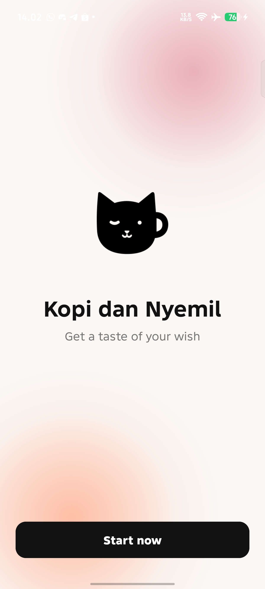
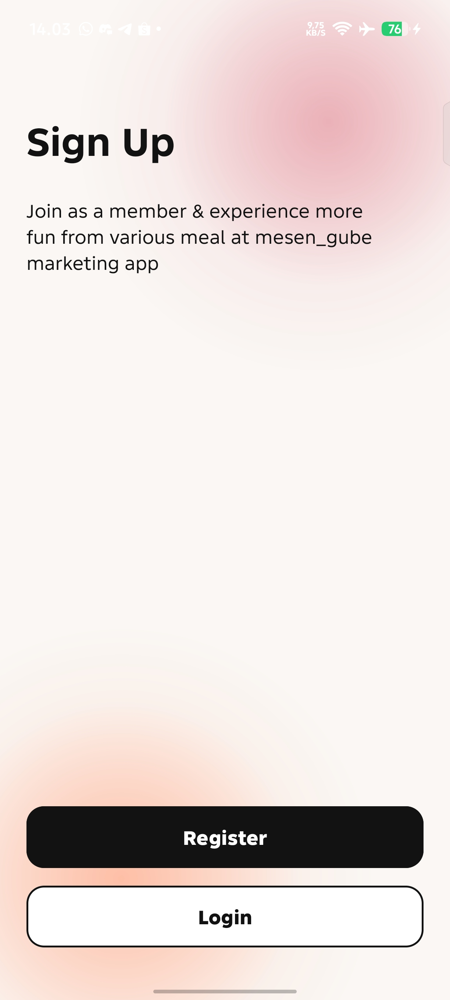
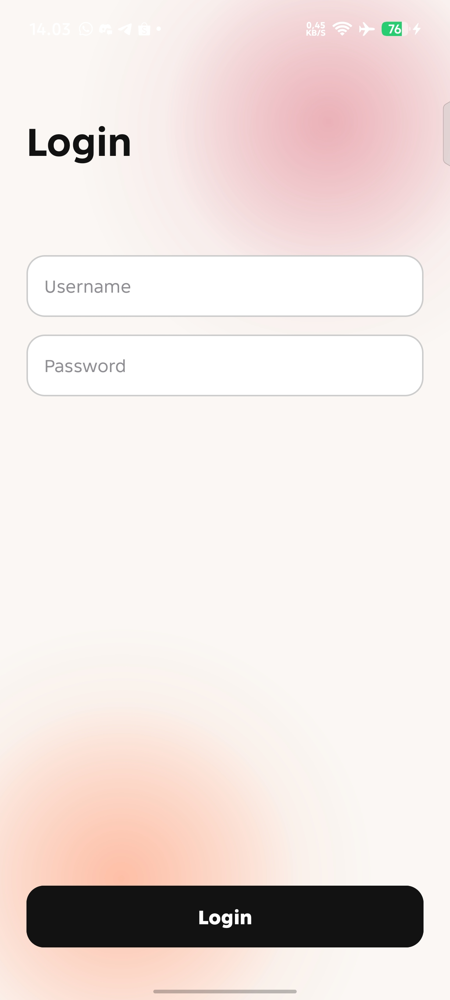
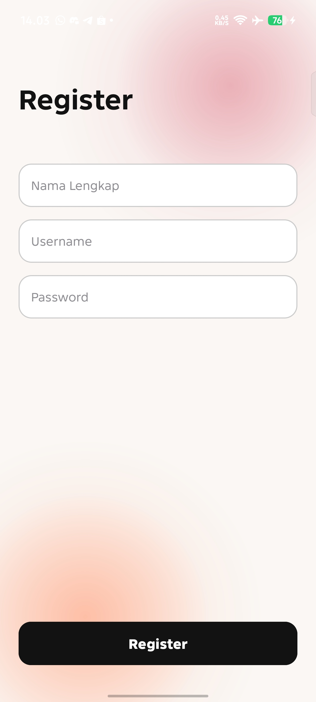
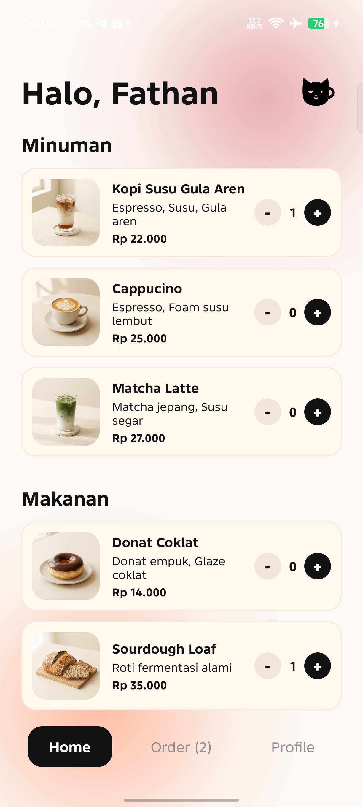
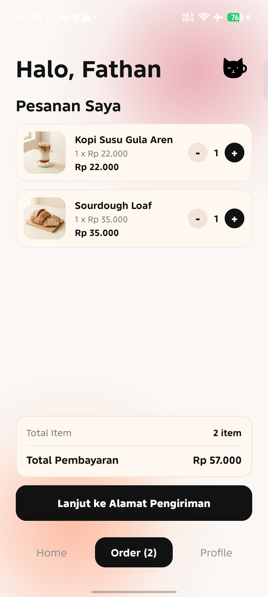
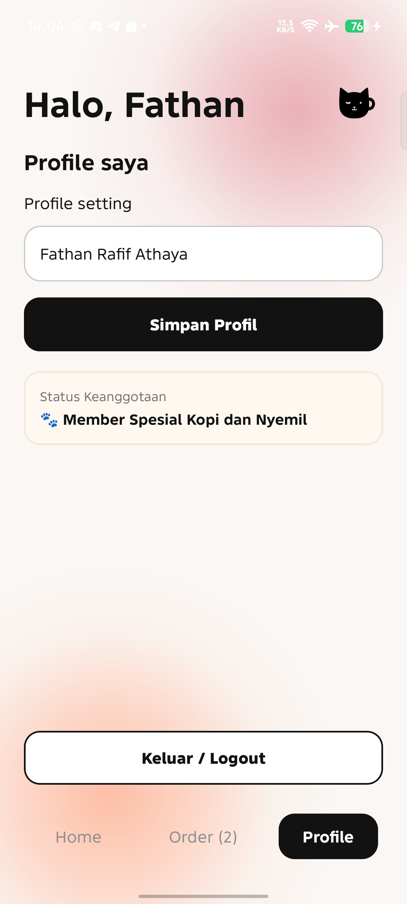
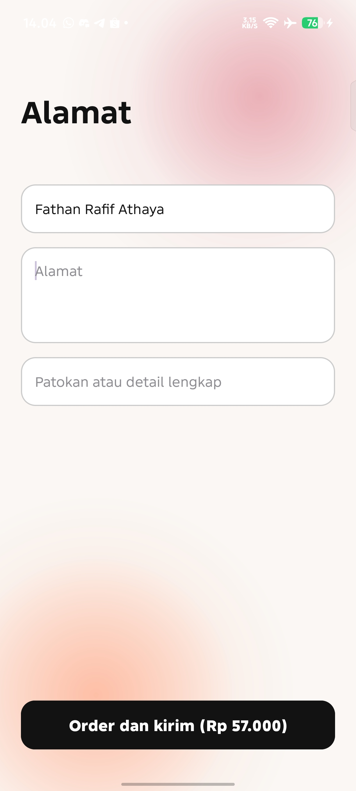
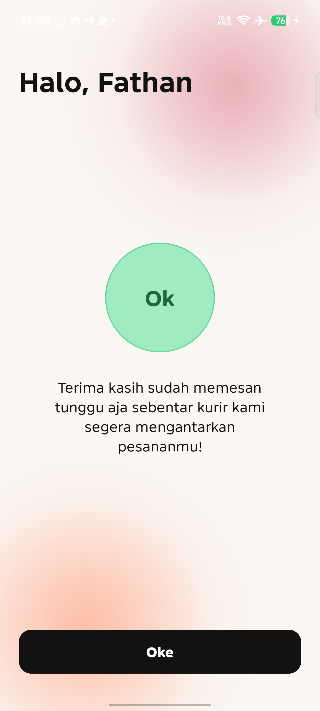

# Kopi dan Nyemil ☕🐾

Aplikasi Android pemesanan kopi dan camilan (**Kopi dan Nyemil**) dengan antarmuka modern, bersih, dan bertema kafenya para pecinta kucing (*cat cafe & bakery*).

---

## 🎨 Desain & Tema
- **Warna Dasar**: Warm Off-White `#FAF7F4`.
- **Radial Blur Glow Background**: Gradien ambient di sudut kanan atas (*soft rose glow*) dan sudut kiri bawah (*soft peach glow*).
- **Logo & Maskot**: Vector logo kucing imut menikmati kopi hangat dan camilan kue.

---

## 📸 Screenshots

| Splash | Sign Up | Login |
| :---: | :---: | :---: |
|  |  |  |

| Register | Home | Order |
| :---: | :---: | :---: |
|  |  |  |

| Profile | Alamat | Konfirmasi |
| :---: | :---: | :---: |
|  |  |  |

---

## 📱 Fitur & Halaman Utama
1. **Splash Screen** ([SplashActivity](app/src/main/java/lat/pam/kopidannyemil/SplashActivity.kt)): Halaman sambutan awal dengan logo kucing, slogan *"Get a taste of your wish"*, dan tombol *"Start now"*.
2. **Sign Up Options** ([SignUpActivity](app/src/main/java/lat/pam/kopidannyemil/SignUpActivity.kt)): Pilihan untuk masuk (*Login*) atau daftar akun baru (*Register*).
3. **Login Screen** ([LoginActivity](app/src/main/java/lat/pam/kopidannyemil/LoginActivity.kt)): Form masuk dengan *username* & *password*.
4. **Register Screen** ([RegisterActivity](app/src/main/java/lat/pam/kopidannyemil/RegisterActivity.kt)): Pendaftaran nama lengkap & *username* yang tersimpan secara tersinkron di [UserSession](app/src/main/java/lat/pam/kopidannyemil/UserSession.kt).
5. **Main Container (Single-Activity Navigation)** ([HomeActivity](app/src/main/java/lat/pam/kopidannyemil/HomeActivity.kt)):
   - **Tab Home**: Menampilkan daftar menu yang dikelompokkan ke dalam kategori **Minuman** (*Kopi Susu Gula Aren, Cappucino, Matcha Latte*) dan **Makanan** (*Donat Coklat, Sourdough Loaf*) dengan teks deskripsi bersih tanpa *bullet point*, dilengkapi kontrol kuantitas (*counter* `-` / `+`).
   - **Tab Order**: Keranjang pesanan real-time. Menampilkan ringkasan produk, rincian subtotal per item, jumlah total barang, dan total pembayaran. Jika belum ada pesanan, menampilkan state keranjang kosong (*empty state*).
   - **Tab Profile**: Pengaturan nama profil pengguna, status keanggotaan member spesial, dan tombol logout.
6. **Alamat Pengiriman** ([AddressActivity](app/src/main/java/lat/pam/kopidannyemil/AddressActivity.kt)): Form pengisian nama pemesan, alamat lengkap, dan detail patokan lokasi dengan kalkulasi total pesanan.
7. **Konfirmasi Pesanan** ([ConfirmActivity](app/src/main/java/lat/pam/kopidannyemil/ConfirmActivity.kt)): Halaman konfirmasi sukses dengan status pesanan diproses kurir dan tombol kembali ke beranda.

---

## 📁 Struktur Proyek
```text
app/src/main/java/lat/pam/kopidannyemil/
├── AddressActivity.kt   # Layar input alamat pengiriman
├── ConfirmActivity.kt   # Layar konfirmasi pesanan berhasil
├── HomeActivity.kt      # Layar utama (Navigasi Tab: Home, Order, Profile)
├── LoginActivity.kt     # Layar Login
├── MenuAdapter.kt       # Adapter RecyclerView daftar menu makanan/minuman
├── OrderAdapter.kt      # Adapter RecyclerView rincian item pesanan
├── RegisterActivity.kt  # Layar pendaftaran akun baru
├── SignUpActivity.kt    # Layar pilihan Register / Login
├── SplashActivity.kt    # Layar Splash sambutan
└── UserSession.kt       # Object helper SharedPreferences sesi pengguna
```

---

## 🛠️ Tech Stack & Persyaratan

### Persyaratan System & Build
- **JDK**: Java 11 atau lebih baru
- **Android Studio**: Android Studio Ladybug / Meerkat atau versi terbaru
- **Minimum SDK**: API 27 (Android 8.0 Oreo)
- **Target SDK**: API 37 (Android 16)
- **Compile SDK**: API 37
- **AGP Version**: 9.5.0

### Library & Framework
- **Kotlin Standard Library**
- **AndroidX Core KTX** (`1.19.1`)
- **AndroidX AppCompat** (`1.8.0`)
- **AndroidX ConstraintLayout** (`2.2.2`)
- **Material Components for Android** (`1.14.0`)
- **Edge-To-Edge Display Support** (`enableEdgeToEdge`)

---

## 🚀 Cara Menjalankan Proyek
1. Clone atau buka direktori proyek di **Android Studio**.
2. Jalankan **Gradle Sync** sampai selesai.
3. Hubungkan perangkat Android (USB Debugging) atau gunakan Android Virtual Device (AVD).
4. Klik **Run 'app'** (`Shift + F10`) di Android Studio, atau jalankan perintah Gradle:
   ```bash
   ./gradlew assembleDebug
   ```
